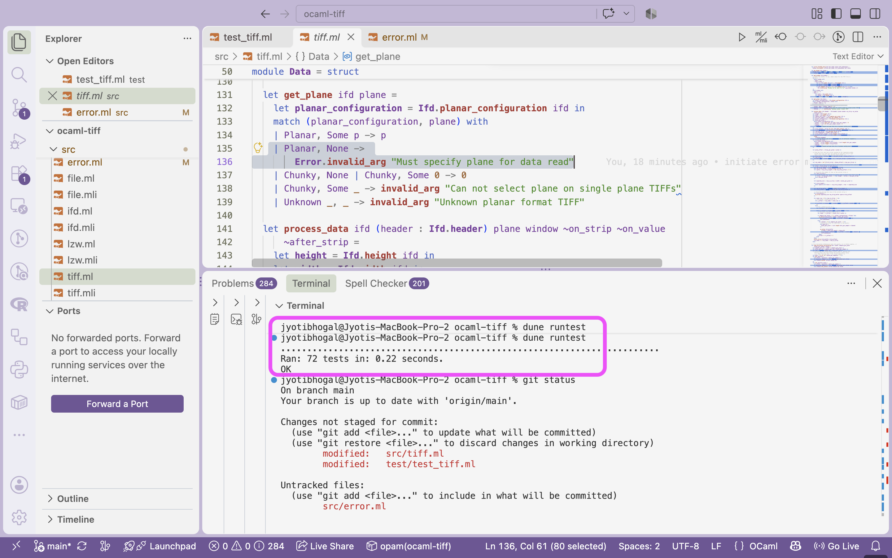

```{r setup, include=FALSE}
knitr::opts_chunk$set(echo = FALSE,
                      out.width = "100%",
                      out.extra="style='border:1px solid black;'")

```

```{r klippy, echo=FALSE, include=TRUE}
klippy::klippy(
  position = c("top", "right"),
  tooltip_message = "Copy code",
  tooltip_success = "Copied!"
)
```

Have you been in a situation where you have encountered error messages that inform you something went wrong, but not much else.

An error like `Invalid_argument` may indicate a problem, but it does not necessarily tell us whether the input was incorrect, a file was malformed, or the software encountered something it does not support.

For users, this can slow them down. For developers, it can mean spending additional time understanding a bug before even beginning to fix it.

This is where **centralised, structured error reporting** becomes useful.

As an open-source contribution to [OCaml-TIFF](https://github.com/geocaml/ocaml-tiff), an OCaml library for reading and writing TIFF files, I explored this through [Issue #81: Structured Error Reporting](https://github.com/geocaml/ocaml-tiff/issues/81).

](image_404_not_found.png)

## What is structured error reporting?

Traditional error handling often relies on messages or exceptions raised from different parts of a codebase.

Structured error reporting introduces a consistent, centralised way to describe failures, typically by combining:

* **Error type:** What kind of problem occurred?  
* **Context:** Where or under what circumstances did it occur?  
* **Description:** What information could help someone investigate it?

For example, distinguishing a malformed TIFF file from an unsupported TIFF feature can help users and developers decide what to do next.

Centralising this information in a dedicated module also gives contributors a common approach to reporting errors, rather than creating different conventions across the codebase.

## What I worked on in OCaml-TIFF?

While working on Issue \#81, I explored how errors were raised across the library.

The implementation involved introducing a dedicated `Error` module, defining structured error categories, adding optional filename information, and providing consistent error formatting.

I also reviewed existing exception-raising functions to identify which TIFF-specific failures should use the new error model.

An important lesson was that **not every exception needs to be replaced**. The goal was to improve meaningful TIFF-specific error reporting without unnecessarily changing unrelated behaviour.

The work also involved updating tests to reflect the new error handling and discussing implementation decisions with the primary OCmal-Tiff maintainer, Patrick Ferris.



## How can better errors accelerate software development?

The benefits extend beyond displaying a clearer message.

**1\. Faster debugging and bug triaging**

When an error identifies the type of failure, developers have a better starting point for investigation. A meaningful error report, combined with a reproducible example, can make it easier to identify and prioritize bugs.

**2\. Identifying opportunities for new features**

An error indicating unsupported functionality can reveal a limitation that users are encountering. Maintainers can use this information when deciding which features to implement next.

**3\. More consistent code development**

A centralised error module provides shared conventions. New contributors can follow existing patterns instead of introducing different ways of reporting similar failures.

**4\. Better testing and maintainability**

Tests can verify not only that software works with valid inputs, but also that it fails in expected and informative ways. This helps prevent regressions as the codebase evolves.

## A broader perspective on debugging

While exploring error handling in OCaml-TIFF, I came across a related observation by Patrick Ferris, the project's primary maintainer and mentor, while discussing exception backtraces in OCaml:

> “Normal OCaml features just work out of the box, like exception backtraces, which are crucial for writing new libraries, using tools, and debugging programs.”

\- Patrick Ferris, [*Love Rust? Then OCaml's New Eio Library is for You*](https://tarides.com/blog/2022-12-27-love-rust-then-ocaml-s-new-eio-library-is-for-you/), Tarides (2022).

This resonated with my work on structured error reporting. While backtraces help developers investigate where failures occur, structured errors help communicate the nature of those failures.

Both contribute to making software easier to understand, debug, and maintain.

## Why does this matter for research software?

Research and scientific software frequently processes complex datasets and file formats. When a workflow fails, researchers need to understand whether the problem comes from the input data, how the software is being used, or a limitation in the tool itself. Clear errors can make troubleshooting easier, support reproducible workflows, and help researchers communicate problems to software maintainers. These benefits are equally relevant to open-source, proprietary, and other software projects.

## What I learned

Working on structured error reporting changed how I think about software failures.

> An error is not just an interruption. It is information that can help us understand and improve software.

I also learned that a seemingly small change to error handling requires thinking carefully about API design, compatibility, testing, and the experience of future contributors.

Better error reporting will not eliminate bugs. But it can make them easier to understand, communicate, and fix.

And sometimes, understanding why software fails is the first step towards deciding what it should support next.

 on [Unsplash](https://unsplash.com/photos/camels-on-desert-under-blue-sky-_VqyrvQi6do?utm_source=unsplash&utm_medium=referral&utm_content=creditCopyText).](sergey-pesterev-_VqyrvQi6do-unsplash.jpg)

____________________________

**Related work and further reading:**

* [OCaml Learning \- Error Handling](https://ocaml.org/docs/error-handling#using-the-result-type-for-errors)   
* [OCaml-TIFF Issue \#81](https://github.com/geocaml/ocaml-tiff/issues/81); [Pull Request \#106](https://github.com/geocaml/ocaml-tiff/pull/106)


## Get In Touch:

**Email:** [bhogaljyoti1@gmail.com](mailto:bhogaljyoti1@gmail.com)   
**LinkedIn:** [jyoti-bhogal](http://www.linkedin.com/in/jyoti-bhogal)  
**GitHub:** [jyoti-bhogal](https://github.com/jyoti-bhogal)   
**Mastodon:** [jyoti_bhogal](https://mastodon.social/@jyoti_bhogal)

**Bluesky:** [jyoti-bhogal.bsky.social](https://bsky.app/profile/jyoti-bhogal.bsky.social)

**Website:** https://jyoti-bhogal.github.io/about-me/index.html

